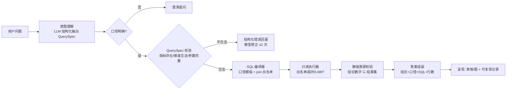

# 赛题一设计方案｜对话式商业智能：经营数据分析 Agent

| 项 | 内容 |
| --- | --- |
| 对应赛题 | 云帐房 AI 技术创新大赛 · 赛题一：对话式商业智能—经营数据分析 |
| 文档版本 | v1.0 |
| 作品形态 | 可运行 Web Demo（LangChain 1.x + SQLite/DuckDB + Streamlit） |
| 技术方向 | 自然语言查询 / 数据分析（Text-to-SQL） |
| 配套文档 | 《赛题二-LangChain实现方案》（同一套技术底座，复用学习成本）；《赛题二-规则整理》（赛制通用规则） |

> 核心目标（官方原文）：**准确、可解释、可核对**。初赛评价第一条就是"公开及未公开问题中的数字、排名、时间范围和指标口径正确"——这是三道题里唯一有标准答案的题，设计的一切都围绕"数字不能错"。

---

## 0. 摘要

赛题一的死穴不在"模型能不能写 SQL"，而在三个具体的坑：

| 死穴 | 官方评价里的对应句 | 出错形态 |
| --- | --- | --- |
| 口径混淆 | "正确区分商品销售额、支付金额和运费" | 把支付流水当销售额、运费计入商品销售 |
| 重复计算 | "正确处理多表关联和复杂业务关系，避免重复计算" | 订单 join 明细/支付后金额翻倍；取消订单未剔除 |
| 归因过度 | "能识别歧义、缺失数据和无法证明的因果结论" | 官方示例题里"增长是否促销带来"——答案必须是**不能断定** |

我们的设计主张一句话：

> **模型不写 SQL，模型只做"翻译"——把自然语言翻译成结构化的查询意图（QuerySpec），SQL 由代码从指标口径定义编译生成。**

这样"口径正确"不依赖模型发挥，而依赖预先审定的口径表；"不重复计算"由编译器里的 join 白名单和聚合策略一次性保证；"不编造归因"由数值溯源 + 归因克制规则兜底。模型负责理解与解释，代码负责计算与守门——和赛题二是同一套哲学，技术底座也复用（LangChain `create_agent` + 中间件）。

---

## 1. 赛题理解

### 1.1 官方要什么（从评价标准倒推）

| 评价维度 | 隐含的技术要求 |
| --- | --- |
| 数字/排名/时间范围/口径正确 | 查询逻辑必须确定性；口径必须显式声明且一致 |
| 确定性计算交给数据库/程序，只读 | 不能让模型生成任意 SQL 直接执行；必须有只读限制 |
| 区分商品销售额/支付金额/运费 | 语义层必须预先定义好这些口径，模型引用而非发明 |
| 识别歧义/缺失/无法证明的因果 | 需要澄清机制 + 数据目录（知道哪些表不存在） |
| 后续完善空间（加表、加指标、加题型） | 语义层配置化：加指标 = 加一行配置，不是改代码 |
| 创新性 | 查询解释、多轮交互、下钻、核对、可视化中做出特色 |

### 1.2 官方示例题透露的评分套路

官方公开示例"4 月 vs 3 月销售额 + 品类贡献 + 是否促销带来"，预期输出有四个层次：

1. 精确数字（167,927.39 / 193,119.68 / 25,192.29 / 15.00%）——考**查询正确性**
2. 按品类差额排序并点名贡献最大者——考**分组聚合与排序**
3. "其他部分品类同期下降"——考**完整性和反例意识**（不是只报好看的数字）
4. "当前数据没有促销活动表，只能确认成交价格和销量发生变化，不能直接断定增长由促销导致"——考**归因克制**

第 4 点最容易被忽视也最能拉开差距：一个"不知道就说不知道"的系统，比一个编出促销故事的系统得分高得多。

### 1.3 数据环境的三个已知陷阱（资料包验证后校准）

| 陷阱 | 典型错误 | 应对 |
| --- | --- | --- |
| 多商品订单 | 订单表金额 join 明细表后按订单计数/求和 → 重复计算 | 商品销售额一律按**明细行**聚合，join 规则白名单固定 |
| 拆分支付 | 一笔订单多笔支付记录；支付金额 ≠ 订单金额 | "支付金额"口径指向支付流水表，与订单表独立聚合 |
| 取消/退款订单 | 未过滤 status | 每个指标定义里内置状态过滤条件，编译器强制注入 |

---

## 2. 总体架构

### 2.1 流水线总览



### 2.2 技术栈与角色分工

| 组件 | 选型 | 职责 |
| --- | --- | --- |
| 对话编排 | LangChain `create_agent` + 中间件 | 多轮对话、追问改写、澄清提问、调用工具 |
| 结构化意图 | `response_format`（Pydantic：QuerySpec） | NL → {指标, 维度, 筛选, 对比} |
| SQL 编译器 | 纯 Python（jinja2 模板 + join 白名单） | QuerySpec → SQL，**模型永不生成 SQL** |
| 执行器 | SQLite（资料包是 Excel/CSV → 导入）或 DuckDB | 只读、超时、LIMIT、行数上限 |
| 溯源校验 | 纯 Python | 结论中的数字必须能在结果集中找到 |
| 呈现 | Streamlit + Altair | 表格、图、可复现记录页 |

与赛题二共用同一套底座（`create_agent` + 中间件 + SQLite + Streamlit），如果两题都准备，学习成本只有一份。

### 2.3 Agent 的工具集

| 工具 | 说明 |
| --- | --- |
| `get_table_schema(table)` | 表结构 + 字段含义 + 数据时间范围 |
| `search_metric(keyword)` | 语义层检索：这个问题对应哪些已定义指标 |
| `run_query(query_spec)` | **主入口**：接收 QuerySpec，经编译→执行→溯源后返回结果 |
| `check_data_quality(table)` | 缺失值/重复/异常日期/金额勾稽检查 |
| `list_available_data()` | 有哪些表、哪些口径可查（防"编造不存在的表"） |

注意：**没有 `execute_sql` 工具**。模型无法绕过语义层，这是架构级的约束。

---

## 3. 语义层（本方案的核心）

### 3.1 指标定义（metric_def）

每个指标的口径是一份配置，不是一段 prompt：

```yaml
metric_id: goods_sales_amount
name: 商品销售额
question_patterns: ["销售额", "卖了多少钱", "GMV"]   # 供模型检索匹配
source:
  from: order_items                                  # 聚合基准：明细行，不是订单
  measure: price                                     # 官方示例：汇总 price，运费不计入
  grain: order_item
  filters:                                           # 编译器强制注入，模型无法绕过
    - "order.status = 'delivered'"                   # 状态过滤随口径走
  excludes: [shipping_fee, payment_amount]           # 显式排除项，防口径混淆
dimensions: [category, merchant, product, month]
time_field: order.created_at
notes: "商品销售额 ≠ 支付金额；不含运费"
```

官方评价里"区分商品销售额、支付金额和运费"对应三个独立指标定义：

| 指标 | 聚合基准 | 度量 | 备注 |
| --- | --- | --- | --- |
| 商品销售额 | `order_items` | `price` 求和 | 不含运费 |
| 支付金额 | `payments`（支付流水） | `paid_amount` 求和 | 拆分支付按流水汇总，与订单表独立 |
| 运费 | `orders` | `shipping_fee` 求和 | 只在订单粒度聚合一次 |

**三个指标三个基准表，从定义上杜绝 join 翻倍**。

### 3.2 QuerySpec：模型唯一允许的输出

```python
class QuerySpec(BaseModel):
    metric_id: str                      # 必须是语义层已有的 metric，模型不能发明
    dimensions: list[str] = []          # 必须在 metric.dimensions 内
    time_range: TimeRange               # {start, end, field=metric.time_field}
    compare_to: TimeRange | None        # 环比/同比
    filters: list[Filter] = []          # 值来自枚举校验（品类/商家名先查字典表）
    intent: Literal["lookup", "compare", "rank", "drill", "contribution"]
```

`run_query` 收到 QuerySpec 后：

1. **校验**：`metric_id` 存在？维度在白名单内？筛选值在字典表里（不存在 → 返回"没有叫这个名字的商家， nearest 是…"）？
2. **编译**：按口径模板拼 SQL，join 只允许白名单内的路径，先按明细聚合再关联。
3. **执行**：只读连接、`LIMIT 1000`、超时 10s。
4. **溯源**：返回值里带结果集，供第 4 节的溯源校验。
5. **返回**：{数据, sql, 口径说明, 执行行数, 数据时间范围}。

校验失败返回结构化错误（`UNKNOWN_METRIC` / `INVALID_DIMENSION` / `FILTER_VALUE_NOT_FOUND`），模型收到后修正重试，最多 2 次——这与赛题二工具层"结构化错误回灌"是同一模式。

### 3.3 覆盖不到的问题怎么办（扩展口）

语义层没有的问题（如"评价星级分布"这类未定义指标）：

- 模型先 `search_metric` 确认无命中 → `list_available_data` 看有哪些表 → 若字段能安全支持，生成**受限 ad-hoc 查询**：只允许单表 + group by + 聚合函数白名单（SUM/COUNT/AVG/MIN/MAX），禁止 join、子查询、写操作，且同样走编译器而非模型裸写 SQL。
- 编译器没有的复杂度 → 直说"这个问题的口径需要先定义"，建议用户确认口径后加入语义层（体现"后续完善空间"）。

---

## 4. 数值溯源与归因克制

### 4.1 数值溯源（Grounding）

答案文本中的每个数字必须能在 `run_query` 返回的结果集中找到（精确匹配或四则运算推导，容差 0.01）。机制与赛题二 4.7.3 相同，移植即用：

- 溯源失败 → 回灌"你引用的数字不在查询结果里"，重写；
- 两次失败 → 只输出结果表格，不加结论。

### 4.2 归因克制（官方示例题的满分答案结构）

当用户问"为什么/是不是因为 X 导致的"：

```python
def attribution_guard(question, spec) -> Verdict:
    cause = extract_cause(question)            # "促销"
    tables = list_available_data()
    if not has_evidence_for(cause, tables):    # 没有促销活动表
        return Verdict(
            can_conclude=False,
            say="数据中没有促销活动记录，只能确认销量和成交价格发生了变化，"
                "不能断定是促销带来的。如需确认，需要补充活动或折扣数据。")
    return run_attribution(spec)               # 有证据才做量价拆分
```

归因有证据时也只用**确定性拆分**（量价分解、贡献度排序），不让模型"分析一下原因"自由发挥——每个归因结论都要能回答"这个数字怎么算出来的"。

---

## 5. 多轮追问与澄清

### 5.1 会话状态（对应加分项：追问继承条件）

```python
class SessionContext(BaseModel):
    company_scope: str | None
    time_range: TimeRange | None          # "那 4 月呢" → 继承其他条件只改时间
    dimensions: list[str]                 # "只看数码家电" → 追加维度筛选
    filters: list[Filter]
    last_metric: str | None
```

每轮输入先经过**改写合并**：小模型把新问题与 SessionContext 合并成独立完整的 QuerySpec（"那 4 月呢" → "4 月的商品销售额，品类=数码家电"），改写结果**回显给用户确认**（"你是想问：4 月数码家电的商品销售额对吧"），避免静默继承错误条件。

### 5.2 澄清策略

| 情形 | 处理 |
| --- | --- |
| 指标歧义（"销售额"可能指商品销售额或支付金额） | **不猜**。反问一次并给出两个口径的定义差异，用户选过一次后记入 SessionContext |
| 时间歧义（"上个月"相对哪天） | 用数据集最大日期为锚点声明："按数据截至 2025-06-30，上个月 = 2025 年 5 月" |
| 筛选值不存在 | 给最接近的候选（模糊匹配字典表） |
| 数据不足（时间范围外无数据） | 直说该范围无数据，报出数据实际覆盖范围 |

---

## 6. 数据质量雷达（加分项）

`check_data_quality` 主动扫描四类问题，结果作为附录挂在答案后（不喧宾夺主）：

| 检查 | 实现 |
| --- | --- |
| 缺失值 | 各字段 null/空串比例，超阈值字段列出 |
| 重复数据 | 订单号重复、明细重复行 |
| 异常日期 | 超出业务范围的日期（如 1970、未来日期） |
| 金额勾稽 | 明细合计 ≠ 订单总额、支付合计 ≠ 应付（按订单抽样核对） |

查询回答时若命中受影响的表，自动附加提示："注意：orders 表有 2.1% 的记录 shipping_fee 为空，涉及运费的口径仅供参考。"

这同时覆盖加分项"发现并说明缺失值、重复数据、异常日期、支付金额与商品金额不一致"。

---

## 7. 答案可核对包（创新性主打）

每个回答固定携带四件套，用户可以逐步核对——直接命中"可解释、可核对"：

```text
【结论】4 月商品销售额 193,119.68 元，环比增长 15.00%（+25,192.29 元）。
        数码家电贡献增长 65,344.55 元，是主要来源；部分品类同期下降。
【口径】商品销售额 = 订单明细 price 求和（不含运费）；
        仅统计状态=delivered 的订单；时间按下单时间。
【查询】SQL（折叠可展开）· 命中 1,204 行 · 执行 0.3s
【数据范围】2025-01-01 ~ 2025-06-30（n=8,412 订单）
```

呈现层（Streamlit）：结论置顶 → 口径徽章（鼠标悬停看定义）→ 可展开 SQL → 表格 → 趋势/构成图（Altair）→ "重跑此查询"按钮。

**可复现查询记录**（加分项）：每次问答存 {问题、改写后的 QuerySpec、SQL、结果快照、时间戳} 到 `query_log` 表，"历史记录"页可回看、可一键重放（数据没变结果必然一致，数据变了会提示差异）——这是"可复现"的落点，也方便我们自己调试。

---

## 8. 评测方案

### 8.1 自建金标准（资料包到手前先造，到手后对齐）

| 组 | 数量 | 覆盖 |
| --- | --- | --- |
| 单指标查数 | 12 | 三大口径各 4 题，含边界时间 |
| 对比与排名 | 8 | 环比/同比、Top-K、贡献分解 |
| 陷阱题 | 10 | 多商品订单求和、拆分支付、取消订单混入、运费混入销售额 |
| 歧义/归因 | 6 | 口径歧义、指代追问、"是不是促销"类无证据归因 |
| 数据质量 | 4 | 含已知缺失/重复的表 |

每题断言：**结果数字与金标准一致（容差 0.01）、口径声明正确、无编造归因、无套话**。

### 8.2 指标

| 指标 | 目标 |
| --- | --- |
| 数字准确率 | ≥ 98%（陷阱题 ≥ 95%） |
| 口径声明正确率 | 100%（来自语义层，硬约束） |
| 歧义澄清率 | 该问的问了 ≥ 90%，不该问的没问（误澄清 ≤ 10%） |
| 归因克制 | 无证据归因题 100% 给出"不能断定" |
| SQL 逃逸 | 模型生成绕过语义层 SQL 的次数 = 0（架构保证） |

---

## 9. 实施排期（若选此题，10.28 → 11.13）

| 天 | 交付 |
| --- | --- |
| D1-D2 | 数据导入 SQLite + 表结构梳理 + 语义层 v0（三大口径 + 2 维度）+ SQL 编译器 |
| D3-D4 | `create_agent` 对话骨架 + QuerySpec 结构化输出 + `run_query` 校验/编译/执行链路 |
| D5-D6 | 溯源校验 + 归因克制 + 澄清/追问改写（SessionContext） |
| D7-D8 | 语义层补全（评价、商家维度）+ ad-hoc 受限查询 + 数据质量雷达 |
| D9-D9 | Streamlit 呈现（表格/图/口径徽章/SQL 折叠）+ query_log 可复现记录 |
| D10-D12 | 金标准 40 题评测 + 陷阱题修复（这三天留足，本题的分差全在这） |
| D13 | benchmark（加分：对比有无语义层/有无溯源的准确率差异）+ 设计说明定稿 |
| D14-D15 | Demo 录制 + 官方公开示例题全链路复现核对 + 打包 |
| D16 | 缓冲 |

## 10. 风险与备选

| 风险 | 对策 |
| --- | --- |
| 资料包字段/口径与假设不符 | 语义层是配置文件，D3 前只动配置不动代码；三大口径定义以数据字典为准 |
| 未公开问题超出语义层覆盖 | ad-hoc 受限查询兜底 + 澄清机制争取理解分 |
| 模型 QuerySpec 输出不稳定 | `response_format` 强约束 + 错误回灌重试；备选：小样本 few-shot 微调提示词 |
| 竞争者都做 Text-to-SQL 撞车 | 差异点打"可核对包 + 归因克制 + 语义层架构"，答辩讲清楚为什么比裸 NL2SQL 准 |

---

**一句话总结**：这题比拼的不是谁 SQL 写得花，而是谁的数字永远对、口径永远说清楚、不知道的永远直说。语义层让"永远对"成为架构保证而非运气，可核对包让评委亲手验证这一点。
