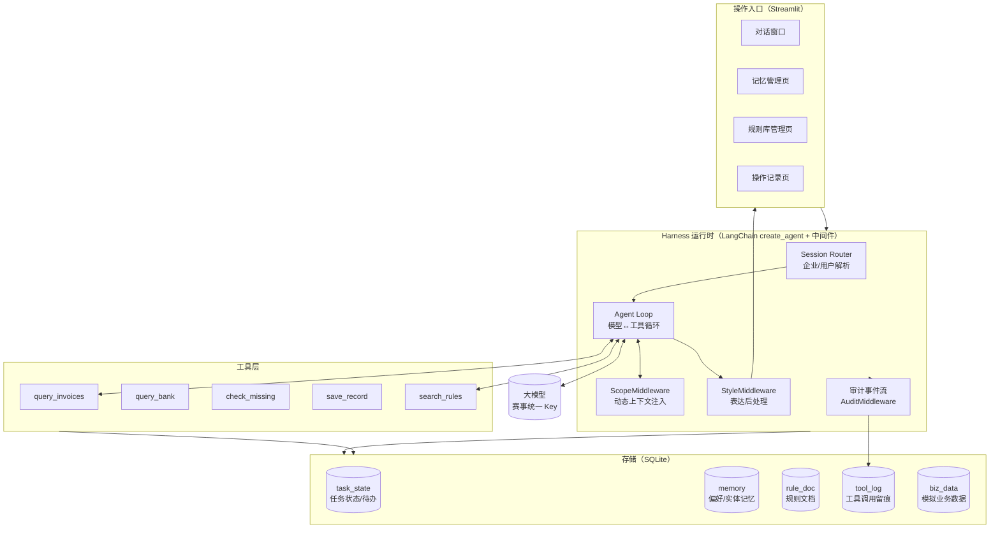
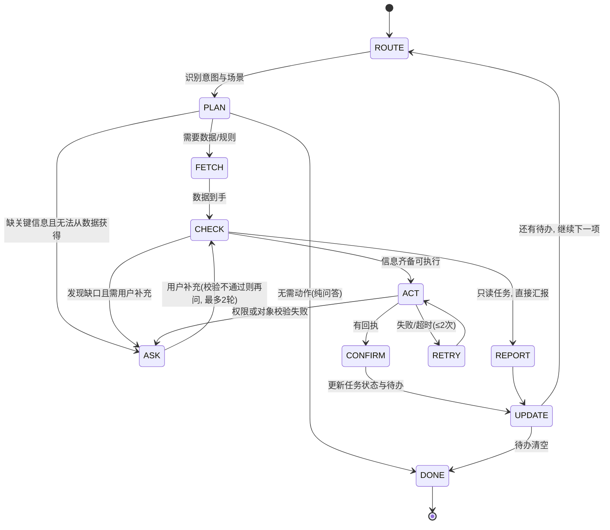
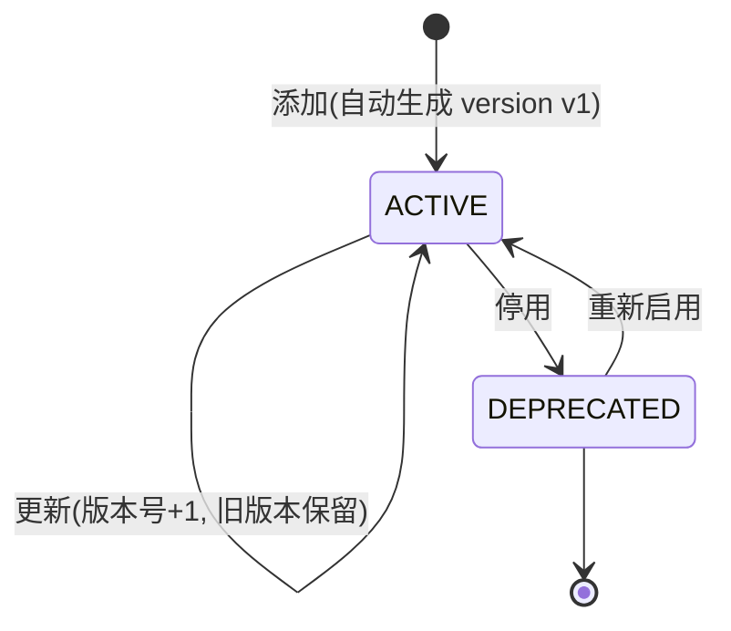

# 财税 Agent Harness 参赛系统设计文档

| 项 | 内容 |
| --- | --- |
| 对应赛题 | 云帐房 AI 技术创新大赛 · 赛题二：财税 Agent Harness 系统设计与实现 |
| 文档版本 | v2.0（初赛提交版，技术路线定稿） |
| 作品形态 | 可运行任务处理系统 |
| 技术栈 | Python 3.11+ / **LangChain 1.4.6（`create_agent`）** / LangGraph 1.2.16 / SQLite / Streamlit |
| 配套文档 | 《赛题二-LangChain实现方案》（初学者开发手册，代码逐块讲解）；《财税 Agent Harness 系统设计》（企业级深度架构，答辩原理支撑）；《赛题二-规则整理》（评分对照表） |

> 阅读指引：第 1 章回答"我们如何理解赛题"，第 2 章回答"系统怎么设计、用什么实现"，第 3-5 章回答"核心机制、三个场景和自然表达怎么落地"，第 9-10 章回答"怎么验证和排期"。第 1.3 节的映射表可对照评分标准阅读。
>
> v2.0 变更：技术路线从"手写 LangGraph 状态图"定稿为"LangChain 1.x `create_agent` + 自定义中间件"（新增 2.3 节），第 10 章排期与附录 A 目录同步更新。

---

## 0. 摘要

赛题描述里点名了多轮财税任务的四种典型失败：**忘记前文、用错旧规则、混淆企业信息、说已保存却没有真正保存**。

我们的设计主张是一句话：

> **把"能忘记的东西"交给模型，把"不能忘记的东西"交给系统。**

模型负责理解意图、组织语言、决定下一步；任务进度、企业隔离、规则版本、工具执行状态、操作记录全部落在系统侧的结构化存储里，每一轮对话由 Harness 重新装配上下文喂给模型。这样即使模型"失忆"，任务也不会丢；即使模型想编一个"已保存"，系统里没有回执就不算完成。

四个失败模式各自对应一个确定性机制，而不是靠 Prompt 求模型别犯错：

| 失败模式 | 对应机制 | 章节 |
| --- | --- | --- |
| 忘记前文 | 任务状态持久化 + 每轮重新装配上下文 | 3.1 / 3.4 |
| 用错旧规则 | 规则文档版本化，检索只返回 `active` 版本并强制引用 | 3.3 |
| 混淆企业信息 | 全链路 `company_id` 作用域隔离 | 3.2 / 6 |
| 说已保存却没保存 | 工具三态回执 + 幂等键 + "无回执不算完成" | 3.5 |

---

## 1. 赛题理解与总体思路

### 1.1 三个场景的共性抽象

官方三个场景（发票与银行查询 → 补充信息并保存 → 多轮检查）表面上不同，抽象出来是同一个循环：

```
理解任务 → 查数据/查规则 → 发现缺口 →（缺信息）询问用户 → 校验 → 执行保存 → 确认回执 → 更新任务状态
```

差异只在"缺口是什么"：

| 场景 | 数据动作 | 典型缺口 | 结束条件 |
| --- | --- | --- | --- |
| ① 发票与银行查询 | 只读查询 + 规则匹配 | 信息不完整、规则要求未满足 | 给出解释，把缺口记为待办 |
| ② 补充信息并保存 | 读 → 问 → 写 | 用户补充的内容本身有错 | 保存回执确认 |
| ③ 多轮检查 | 承接前两场景的未完成事项 | 上下文跨多轮、跨天 | 待办清空或用户中止 |

因此本系统不做三个独立流程，而是**一套状态机 + 三个场景配置**。这正是赛题"三个场景需要共用同一套任务处理流程"的实现方式，也让复赛遇到新场景时只需加配置而不是改代码（后续完善空间）。

### 1.2 一个关键取舍：记忆只记"用户明确提出的"

赛题要求记忆系统"记住任务进度和用户明确提出的长期偏好"。我们刻意把边界划在这里：

- 用户说"以后我们公司的发票用途统一填办公用品" → 写入长期偏好。
- 用户只是这次填了"办公用品" → **不写**，只进任务状态。

理由：**自动推断出来的"偏好"一旦错了，会以正确的姿态污染后续所有任务**，而且用户不知道系统记了什么，无从更正。宁可少记、可查、可删，不要聪明但不可信。这个取舍在答辩时可以直接对应评分维度"模型和规则的边界是否合理"。

### 1.3 官方基础任务 → 系统模块映射

| 官方要求 | 本系统模块 | 关键设计 |
| --- | --- | --- |
| 统一运行 | 任务循环状态机（3.1） | 每轮决策四选一：查规则 / 调工具 / 问用户 / 结束 |
| 记忆管理 | 记忆系统（3.2） | 三类记忆 + 全量 CRUD + 企业/用户双隔离 |
| 知识库管理 | 规则库（3.3） | 版本化 + 状态机（active/deprecated）+ FTS5 检索 |
| 上下文管理 | Context Assembler（3.4） | 分层装配 + token 预算 + 待办事项保底 |
| 工具执行 | 工具层（3.5） | 三态回执 + 幂等键 + 写前五项校验 |
| 过程可检查 | 审计事件流（3.6） | 每次工具调用、记忆读写、规则引用全留痕 |
| 自然表达 | 表达层（第 5 章） | **确定性后处理管线**，不依赖模型自觉 |

---

## 2. 总体架构

### 2.1 架构图



选型说明：

- **LangChain 1.x（`create_agent`）**：底层即 LangGraph。一行代码获得"模型↔工具循环"、检查点、长期记忆库与中间件钩子，官方内置 `SummarizationMiddleware`（加分 1）、`HumanInTheLoopMiddleware`（interrupt 暂停）、`ToolCallLimitMiddleware`（防失控）、`ModelFallbackMiddleware`（模型降级）——赛题核心需求大半白嫖官方组件，自研集中到四个中间件（见 2.3）。
- **SQLite 单文件**：零部署依赖，评审 clone 即跑；表结构与 PostgreSQL 完全兼容，"后续完善空间"演示时可一键切换。
- **Streamlit**：一个文件出一个带四个页面的管理台，把 16 天工期留给核心逻辑。

### 2.3 技术路线定稿：机制 → LangChain API 映射

所有 API 均已在本机安装的 langchain 1.4.6 / langgraph 1.2.16 源码中验证。

| 设计机制 | LangChain 落点 | 自研/内置 |
| --- | --- | --- |
| 统一运行（agent loop） | `create_agent` 内置"模型↔工具循环" | 内置 |
| 跨轮任务记忆 | `checkpointer=SqliteSaver` + `thread_id=task:{id}` | 内置 |
| 长对话摘要（加分 1） | `SummarizationMiddleware` | 内置 |
| 保存前人工确认（可选） | `HumanInTheLoopMiddleware`（LangGraph interrupt） | 内置 |
| 防失控 | `ToolCallLimitMiddleware` / `ModelCallLimitMiddleware` | 内置 |
| 模型降级 | `ModelFallbackMiddleware` / `ModelRetryMiddleware` | 内置 |
| 动态上下文注入（企业/待办/记忆/规则） | 自研 `ScopeMiddleware`（`wrap_model_call` 钩子） | **自研** |
| 审计留痕 | 自研 `AuditMiddleware`（`wrap_tool_call` 钩子） | **自研** |
| "无回执不得说已保存" | 自研 `ReceiptGuardMiddleware`（`after_model` 钩子） | **自研** |
| 去 AI 味后处理 | 自研 `StyleMiddleware`（`after_model` 钩子） | **自研** |
| 工具三态幂等 | 工具函数内部实现（与框架无关） | **自研** |

四个自研中间件就是"模型和规则的边界"的工程化表达：**上下文内容由 Scope 决定、每步有 Audit、状态断言过 Receipt、语言风格过 Style**。

实现侧两个必须记住的坑（完整 FAQ 见《赛题二-LangChain实现方案》第 10 章）：

1. `after_model` 改写消息**必须保留原 message id**（LangGraph 的 `add_messages` 按 id 替换，换 id 会变成追加，模型的话会出现两遍）。
2. `langgraph-checkpoint-sqlite` 需单独安装（易漏装）；Streamlit 多线程下 SQLite 连接要 `check_same_thread=False`。

**为什么不下沉到裸 LangGraph 手写状态图**：3.1 节的状态机在 LangChain 路线下由"agent loop + 中间件"自然实现（对应关系见 3.1 末尾的表）。只有当需要并行子图、或要把校验做成与模型无关的强节点时才需要下沉；而 `create_agent` 的返回值就是 `CompiledStateGraph`，复赛遇到复杂新场景可无缝加自定义节点——升级路径平滑，不必推倒重来。

### 2.2 一次任务的完整数据流

以赛题原文的例子走一遍：用户查询某企业发票与银行收支，发现一张发票缺"用途"，询问后保存。

```mermaid
sequenceDiagram
    participant U as 用户
    participant O as 任务循环
    participant M as 记忆/规则
    participant T as 工具层
    participant L as 大模型

    U->>O: 查一下 A 公司 9 月发票和银行收支
    O->>M: 装配上下文(企业=A, 月份=9, 待办=[])
    O->>T: query_invoices(A, 2026-09)
    O->>T: query_bank(A, 2026-09)
    O->>T: check_missing(发票列表)
    T-->>O: 发票 INV-007 缺"用途"字段
    O->>L: 汇总数据+缺口, 生成回复
    L-->>U: 查到 12 张发票、8 笔收支; INV-007 缺用途, 需要补充
    O->>M: task_state 写入待办[INV-007 补用途]
    U->>O: 用途是办公用品
    O->>T: save_record(INV-007, {purpose: 办公用品}, idem_key)
    T-->>O: status=success, receipt=R-1024
    O->>M: 待办清除, 审计留痕
    O->>L: 生成确认回复(必须引用回执号)
    L-->>U: 已保存, 回执 R-1024
```

两个设计点值得注意：

1. **每轮都重新装配上下文**。模型不持有跨轮状态，上一轮的结果从 `task_state` 读出来放进上下文。模型失忆不影响任务。
2. **"已保存"的判定权在工具回执**。模型的确认话术必须引用回执号，回执号来自 `tool_log`。没有回执，表达层会强制改写为"保存未完成"。

---

## 3. 核心机制设计

### 3.1 统一任务循环（状态机）



每轮的决策由**规则优先、模型兜底**：

- 路由（ROUTE）与校验（CHECK）用确定性代码：意图分类可以用小模型，但"保存前五项校验"必须是代码。
- 只有 PLAN 环节（决定下一步做什么、怎么问）交给大模型。
- `ASK` 环节设置**问题预算**：同一缺口最多追问 2 轮，仍不满则明确告知"信息不足，该项暂挂起"并写入待办，不无限纠缠。

**在 LangChain 路线下的实现方式**——状态机不是手写的图，而是由 agent loop 和中间件自然承载：

| 状态机节点 | LangChain 里的位置 |
| --- | --- |
| ROUTE / PLAN | agent loop（模型自己决定调哪个工具、要不要问用户） |
| FETCH | 工具调用 |
| CHECK | 工具内部校验 + 结构化错误返回（模型看到错误自行重试或追问） |
| ASK | 模型生成提问（无需显式 interrupt；`HumanInTheLoopMiddleware` 只用于保存前可选确认） |
| ACT / CONFIRM | `save_record` 三态回执 + `ReceiptGuardMiddleware` 守门 |
| UPDATE | `audit_event` 写入 + `pending_items` 更新（ScopeMiddleware 每轮读回） |
| RETRY | 模型看到 `failed` 结果后重试，`ToolCallLimitMiddleware` 封顶 |

### 3.2 记忆系统

#### 3.2.1 三类记忆

| 类型 | 表 | 内容 | 写入条件 | 生命周期 |
| --- | --- | --- | --- | --- |
| 任务状态 | `task_state` | 当前任务、已完成步骤、**未完成事项（pending_items）** | 系统每轮自动更新 | 任务关闭后归档 |
| 用户偏好 | `user_pref` | 用户明确说出的长期偏好 | **仅当用户语句被识别为明确偏好声明**，写入前在对话里回显确认 | 永久，可更正/删除 |
| 企业事实 | `company_fact` | 与企业绑定的业务事实（如"该供应商开票习惯"） | 用户明确提出或操作过程中产生 | 永久，可更正/删除 |

偏好写入的确认交互（避免误记）：

> 用户："以后用途都写办公用品。"
> 系统："好的，已记住：A 公司发票用途统一填'办公用品'。这条会一直生效，需要改的话在'记忆管理'里随时改。"

若识别置信度低（用户只是随口一提），系统不写记忆，而是在任务状态里作为本次会话的临时规则。

#### 3.2.2 隔离与 CRUD

- 每条记忆带 `company_id + user_id` 双作用域，Context Assembler 只装配当前作用域的记忆。**不同企业/用户的记忆物理上不会同时出现在一次模型调用里**，这是"不混用"的实现方式。
- 记忆管理页提供三操作：查看（按作用域过滤、显示写入时间与来源对话引用）、更正（编辑后旧值入历史表）、删除（软删除，审计留痕）。
- 记忆被更正/删除后，**同一会话内立即生效**：Context Assembler 每轮实时读取，不存在缓存旧记忆的问题（对应加分项 2）。

### 3.3 知识库（规则文档）

#### 3.3.1 文档生命周期



- 规则检索**只返回 `active` 文档**——这是"用错旧规则"的系统性解法：旧版本还在库里（可追溯），但永远进不了模型上下文。
- 每条检索结果带 `doc_id + version`，回答引用规则时必须带上（赛题要求"回答注明所用文档及版本"），引用信息来自检索返回值而不是模型记忆。
- 检索用 SQLite FTS5 全文匹配（中文分词用 jieba 预处理）。资料包规则量在几十条量级，FTS 足够且零依赖；留了向量检索的适配接口，复赛数据变复杂可切换。

#### 3.3.2 "依据不足时明确说明"

当检索无命中或命中分数低于阈值时，系统不说"根据规定……"，而是：

> "现有规则库里没查到对这条的规定。按通用做法应该是 X，但这不是库里的规则，你可以补充一条规则文档，我下次就按它执行。"

这条行为写进表达层硬规则，并通过测试集验证。

### 3.4 上下文管理（Context Assembler）

每轮模型调用的上下文按固定顺序装配，总量控制在预算内（默认 8k token，可配置）：

| 序 | 内容 | 来源 | 预算 |
| --- | --- | --- | --- |
| 1 | 系统指令（角色 + 硬规则 + 输出格式） | 版本化文件 | 15% |
| 2 | 当前作用域（企业、月份、用户） | Session Router | 2% |
| 3 | 任务状态与**未完成事项** | `task_state` | 15% |
| 4 | 本轮相关记忆（最多 5 条，带"记忆"标签） | `memory` | 10% |
| 5 | 本轮检索到的规则（带 doc_id/version） | `rule_doc` | 20% |
| 6 | 近 6 轮对话（更早的折叠为摘要） | 会话存储 | 25% |
| 7 | 最近工具结果（原文截断，超长给摘要） | `tool_log` | 10% |
| 8 | 输出空间预留 | — | 3% |

裁剪规则（当超预算时按优先级从低到高砍）：

1. 工具结果先折叠为摘要（保留金额、单号等关键字段）。
2. 早期对话轮次合并进摘要。
3. **永不裁剪**：待办事项、当前企业/月份、活跃规则、最近一轮问答。

"未完成事项永不裁剪"是防"忘记前文"的保底手段——哪怕上下文被压到极限，Agent 也知道手里还有什么没办完。

长对话摘要（加分项 1）的触发条件：对话超过 12 轮或 token 超 6k 时，把早期轮次交给小模型整理成"已确认事实 + 已完成动作 + 未完成事项"三段式摘要，替换原文。摘要同样写入审计，可回看原文。

### 3.5 工具执行

#### 3.5.1 工具清单（以资料包为准增删）

| 工具 | 类别 | 说明 |
| --- | --- | --- |
| `query_invoices(company, period, filters)` | 读 | 查发票列表与字段 |
| `query_bank(company, period)` | 读 | 查银行收支流水 |
| `check_missing(invoice_ids)` | 计算 | 按规则库校验必填字段，返回缺口清单 |
| `search_rules(query)` | 读 | 规则检索，返回 doc_id/version/原文 |
| `save_record(target, patch, idempotency_key)` | **写** | 保存修改，唯一写入口 |
| `get_save_result(idempotency_key)` | 读 | 按幂等键查上次保存结果（重启恢复用） |

#### 3.5.2 写前五项校验

`save_record` 执行前必须全部通过，任何一项不通过返回结构化错误：

| 校验 | 内容 | 失败错误码 |
| --- | --- | --- |
| 企业 | 目标对象属于当前会话企业 | `COMPANY_MISMATCH` |
| 对象 | 目标记录存在且未被锁定 | `TARGET_NOT_FOUND` |
| 内容 | 补充字段符合规则库要求（类型/枚举/格式） | `INVALID_CONTENT` |
| 权限 | 当前用户角色可修改该字段 | `PERMISSION_DENIED` |
| 重复 | 幂等键未出现过 | `DUPLICATE` |

#### 3.5.3 三态回执与幂等

`save_record` 返回统一三态：

```json
{"status": "success", "receipt_id": "R-1024", "saved_at": "...", "patch_applied": {...}}
{"status": "processing", "job_id": "J-88", "retry_after_s": 2}
{"status": "failed", "error_code": "INVALID_CONTENT", "detail": "...", "retryable": false}
```

- **幂等键**由 Harness 生成：`sha256(company_id + 对象ID + patch内容)`。同一修改重复提交，第二次直接返回第一次的回执，不落两次库——这是"避免重复操作"的最终保证。
- **"无回执不算完成"**：`CONFIRM` 状态机节点校验回执存在才允许生成确认话术；`processing` 状态下 Agent 说"正在保存，保存好我告诉你"，并用 `get_save_result` 轮询，绝不预支"已保存"三个字。
- **重启恢复**（加分项 3）：LangGraph checkpoint 持久化每轮状态；进程重启后恢复任务时**先调 `get_save_result` 查上次幂等键的结果**，有回执则跳过保存直接确认，无回执才重新执行。演示脚本里专门安排一次"保存到一半 Ctrl+C 重启"的环节。

### 3.6 过程可检查（审计事件流）

所有关键动作写入 `audit_event`（append-only）：

| 事件类型 | 记录内容 |
| --- | --- |
| `TOOL_CALLED` | 工具名、入参、返回状态、耗时、幂等键 |
| `MEMORY_READ/WRITE/CORRECTED/DELETED` | 记忆条目、作用域、操作者（system/user） |
| `RULE_CITED` | 本次回答引用的 doc_id + version + 命中分数 |
| `ASK_USER` | 问了什么、为什么问、来自哪个缺口 |
| `STATE_CHANGED` | 待办事项增删、任务阶段迁移 |
| `LLM_CALLED` | 模型档位、token 用量、耗时（供加分项 4 的对比测试） |

操作记录页按任务时间线展示以上事件。这一层同时服务三个评分点：过程可检查（基础任务）、操作记录查看（提交物）、对比测试数据采集（加分项 4）。

---

## 4. 三个场景的实现

### 4.1 场景一：发票与银行查询

**流程**：解析企业/月份 → 并行查发票与银行流水 → 按规则库核对完整性 → 汇报结果 + 挂起缺口。

关键行为：

- 查询结果**先给结论再给明细**（去 AI 味规则之一）："12 张发票、8 笔收支，其中 1 张有问题" → 用户追问才展开明细。
- 发现缺口（缺用途、税号错位、金额与银行流水对不上）时不自作主张修复，而是：报告缺口 + 说明规则依据（引用 doc_id/version）+ 写入待办。
- 若数据里根本没有该企业/月份的数据，直说"没查到"，并报出尝试过的查询条件，不编造。

### 4.2 场景二：补充信息并保存

这是最能拉开差距的场景，因为涉及"问 → 校验 → 写 → 确认"的完整闭环：

1. **问**：缺口转成具体问题（"INV-007 的用途是什么？"），不问宽泛问题。
2. **校验用户补充**：拿到"办公用品"后先过规则库（该字段允许的枚举/格式），通过才进入保存；不通过则说明错在哪、该怎么填，重新问。同一缺口最多两轮，之后挂起。
3. **写**：生成幂等键，调 `save_record`，处理三态分支（见 3.5.3）。
4. **确认**：引用回执号告知结果，同步更新待办。

一个容易被忽略的点：**用户补充的信息也要过企业校验**——如果用户当前会话在 A 公司，却要改 B 公司的发票，必须拒绝并说明，这正是"混淆企业信息"失败的现场拦截。

### 4.3 场景三：多轮检查

多轮检查的本质是**以待办事项为锚点驱动对话**：

- 每轮开始，Context Assembler 把 `pending_items` 放进上下文的"永不裁剪"区。
- 用户回来问"上次那事怎么样了"，Agent 从 `task_state` 读出待办清单直接回答，而不是重新查一遍数据。
- 处理完一项划掉一项；用户提出新任务时，若与已有待办相关（如同一家公司的另一张发票），Agent 主动关联："这和刚才 INV-007 是同一家公司的，一起处理吗？"
- 跨天场景（用户第二天回来）依赖 checkpoint + `task_state` 持久化，不依赖会话进程存活。

### 4.4 端到端示例对话（去 AI 味风格）

> **用户**：帮我看看星辉贸易 9 月的发票和银行流水，有没有问题。
>
> **系统**：9 月星辉贸易有 12 张进项发票、8 笔银行收支，金额都能对上。有一张发票缺信息：INV-202609-007（9 月 14 日，3.6 万元，供应商恒达文具）缺"用途"字段，按规则库《发票入账规范 v2》用途是必填项。补一下我就能帮你把它处理掉。
>
> **用户**：用途是办公用品。
>
> **系统**：已保存。INV-202609-007 用途改为"办公用品"，回执 R-1024。9 月的发票就都齐了。
>
> **用户**：对了，以后我们公司发票用途都默认写办公用品。
>
> **系统**：记下了：星辉贸易的发票用途默认"办公用品"。以后遇到缺用途的发票我会先按这个填，你再确认。这条在"记忆管理"里可以随时改或删。

这段示例同时展示：先结果后细节、引用规则版本、回执号、待办闭环、记忆回显确认、无一处"好的，很高兴为您服务"。

---

## 5. 自然表达设计（去 AI 味）

### 5.1 为什么做成后处理管线

"少套话、少重复、不机械列点"如果只写进 Prompt，效果随机且不可测试。本系统把表达约束做成**确定性后处理**：模型产出初稿 → 表达层检测违规模式 → 触发重写（带具体违规反馈）→ 仍不过关则规则改写。这与赛题"模型和规则的边界是否合理"的评分关注直接呼应：**语言质量的底线交给代码保证，风格的上限交给模型**。

### 5.2 硬规则清单（后处理检测项）

| # | 规则 | 检测方式 | 处置 |
| --- | --- | --- | --- |
| 1 | 先说结果，再说过程 | 检测首句是否含结论性信息（数量/金额/状态） | 不通过则重写并要求结论前置 |
| 2 | 禁用套话开场/收尾 | 黑名单正则："好的""当然""很高兴""希望对您有帮助""如有疑问请随时"等 | 直接删除，无需重写 |
| 3 | 不机械列点 | 短回复（<3 个信息点）中出现无序列表 | 合并为自然句 |
| 4 | 不重复用户原话 | 首句复述用户问题超过 70% 重合 | 删除复述段 |
| 5 | 不确定必须直说 | 输出含数据引用但证据缺失（走 grounding 校验） | 强制改写为"没查到/信息不足" |
| 6 | 完成状态与回执一致 | 有"已保存"字样但无回执引用 | 强制改写为"保存未完成"及原因 |
| 7 | 句长与总量控制 | 单句 >60 字或回复 >200 字（确认类） | 拆句 / 精简 |

规则 5、6 是把 3.5 的工具回执机制延伸到了语言层：**Agent 说出口的每个状态断言都必须有系统证据**。

### 5.3 改写示例

模型初稿：

> 好的！收到您的需求。经过查询，我为您找到了以下信息：2026 年 9 月，星辉贸易有限公司共有发票 12 张，银行收支记录 8 笔。需要注意的是，其中发票 INV-202609-007 缺少"用途"字段信息。根据《发票入账规范》第 3 条的规定，用途为必填字段。希望以上信息对您有帮助，如有疑问请随时告诉我！

后处理输出：

> 9 月星辉贸易有 12 张发票、8 笔收支，金额都能对上。有一张发票缺信息：INV-202609-007 缺"用途"，按《发票入账规范 v2》这是必填项。补一下我就能处理。

信息一点没少，篇幅减半，且规则引用带上了版本号。

---

## 6. 数据模型（SQLite DDL 要点）

```sql
-- 会话作用域：所有业务表带 company_id，记忆类表再加 user_id
CREATE TABLE task_state (
    task_id       TEXT PRIMARY KEY,
    company_id    TEXT NOT NULL,
    user_id       TEXT NOT NULL,
    scenario      TEXT,                      -- query|amend|review
    stage         TEXT NOT NULL,             -- 状态机当前阶段
    pending_items JSON NOT NULL DEFAULT '[]',-- 未完成事项（永不裁剪区）
    facts         JSON NOT NULL DEFAULT '{}',-- 已确认事实
    checkpoint_id TEXT,                      -- LangGraph checkpoint 引用
    updated_at    TEXT DEFAULT (datetime('now'))
);

CREATE TABLE memory (
    memory_id   TEXT PRIMARY KEY,
    company_id  TEXT NOT NULL,
    user_id     TEXT,
    mem_type    TEXT NOT NULL,               -- user_pref | company_fact
    content     TEXT NOT NULL,
    source_ref  TEXT,                        -- 来源对话消息 id（可回看）
    status      TEXT DEFAULT 'active',       -- active | corrected | deleted
    created_at  TEXT, updated_at TEXT
);
CREATE INDEX idx_mem_scope ON memory(company_id, user_id, status);

CREATE TABLE rule_doc (
    doc_id     TEXT NOT NULL,
    version    INTEGER NOT NULL,
    title      TEXT NOT NULL,
    content    TEXT NOT NULL,
    status     TEXT DEFAULT 'active',        -- active | deprecated
    effective_from TEXT,
    created_at TEXT,
    PRIMARY KEY (doc_id, version)
);
CREATE VIRTUAL TABLE rule_fts USING fts5(title, content, content='rule_doc');

CREATE TABLE tool_log (
    log_id     INTEGER PRIMARY KEY AUTOINCREMENT,
    task_id    TEXT NOT NULL,
    company_id TEXT NOT NULL,
    tool_name  TEXT NOT NULL,
    args       JSON, result JSON,
    status     TEXT,                         -- success | processing | failed
    idem_key   TEXT,
    receipt_id TEXT,
    latency_ms INTEGER,
    created_at TEXT DEFAULT (datetime('now'))
);
CREATE UNIQUE INDEX uq_idem ON tool_log(company_id, idem_key)
    WHERE status = 'success';                -- 数据库级防重复保存

CREATE TABLE audit_event (
    event_id   INTEGER PRIMARY KEY AUTOINCREMENT,
    task_id    TEXT, company_id TEXT,
    event_type TEXT NOT NULL,                -- 见 3.6 事件类型表
    payload    JSON NOT NULL,
    created_at TEXT DEFAULT (datetime('now'))
);
```

要点：`uq_idem` 是部分唯一索引，把"同一企业同一幂等键只允许一条 success 记录"下沉到数据库层，应用层怎么出错都重复保存不了。

---

## 7. 加分项落地设计

| 加分项 | 本方案对应设计 | 完成成本 |
| --- | --- | --- |
| 1 长对话摘要 | 3.4 节：超 12 轮触发三段式摘要（事实/已完成/未完成），替换早期轮次 | 低 |
| 2 记忆/规则/企业变更后仍正确 | 3.2.2 / 3.3.1：记忆与规则**每轮实时读取**（无缓存），作用域切换即重装配；测试集含"改记忆→立刻生效""切企业→记忆不串"两类用例 | 低 |
| 3 超时/重启恢复 | 3.5.3：LangGraph checkpoint + 幂等键 + `get_save_result` 先查后做；Demo 安排现场重启环节 | 中 |
| 4 对比测试（正确率/耗时/费用） | `audit_event.llm_called` 全量采集；提供 `benchmark.py` 跑四组配置：{有无记忆} × {有无规则检索} × {有无上下文裁剪}，输出正确率/耗时/token 成本对照表 | 中 |

加分项 4 的对照组是精心挑的：它直接演示"记忆有用在哪、检索有用在哪、裁剪省了多少钱"，比单纯报一个总分更有说服力，也正是主办方想知道的答案。

---

## 8. 稳健性与失败处置

| 失败场景 | 处置 | 不允许发生的事 |
| --- | --- | --- |
| 模型超时/限流 | 指数退避重试 2 次 → 降级为"规则模式"（能查能存，但追问改为固定话术） | 整个系统不可用 |
| 工具返回 `processing` 超过轮询上限 | 告知"正在处理，稍后到操作记录页看结果"，任务挂起并写入待办 | 谎报成功或失败 |
| 用户补充信息连续 2 次校验不过 | 明确说明错误原因，该项挂起待办，不无限追问 | 擅自用猜测值保存 |
| 幂等键冲突（重复提交） | 返回首次回执，并提示"这条刚才已经保存过了" | 重复落库 |
| 检索无规则命中 | 坦承无依据 + 建议补充规则文档 | 编造"根据规定" |
| 会话中切换企业 | 作用域硬切换 + 提示记忆不互通 | 带着上家企业的上下文继续答 |

---

## 9. 验证与演示方案

### 9.1 自建测试集

资料包未到之前，先按赛题描述构造 30 个用例（资料包到手后替换为官方 Case 并保留结构）：

| 组 | 数量 | 覆盖点 |
| --- | --- | --- |
| 查询类 | 10 | 正常查询、无数据、跨月份、多轮追问 |
| 保存类 | 10 | 正常保存、信息校验失败、重复保存、越权保存、回执三态 |
| 多轮类 | 10 | 中断后回来、记忆更正后行为变化、规则停用后引用变化、切企业 |

每个用例标注**可机检的断言**：如"出现回执号"、"audit_event 中 save_record 恰好 1 条 success"、"回复不含黑名单套话"、"引用的 doc version == 当前 active 版本"。

### 9.2 指标

| 指标 | 定义 | 目标 |
| --- | --- | --- |
| 任务完成率 | 待办按预期闭环的用例占比 | ≥ 95% |
| 保存正确率 | 有回执且库内数据与意图一致的占比 | 100%（硬约束） |
| 无重复保存 | 幂等用例中 success 记录数 = 1 | 100%（硬约束） |
| 引用准确率 | 规则引用的 doc/version 与实际命中一致 | 100% |
| 表达达标率 | 通过 5.2 全部硬规则检测的回复占比 | ≥ 95% |
| 记忆准确率 | 写入的偏好与用户原意一致、无跨企业串写 | ≥ 98% |

### 9.3 Demo 脚本（录屏 + 现场）

按"官方四个失败模式逐一现场击破"编排，比功能罗列更有记忆点：

1. 连续任务不丢上下文（多轮检查）
2. 保存中途 **Ctrl+C 杀进程重启** → 恢复任务 → 先查上次结果 → 不重复保存（加分项 3 的现场版）
3. 改一条记忆 → 下一轮立即按新偏好执行（加分项 2）
4. 同一句提问分别用"基线 Prompt Agent"和"本系统"回答，对比去 AI 味效果
5. 展示操作记录页：刚才每一步的工具调用、规则引用、记忆读写全部可回看

---

## 10. 实施排期（10.28 → 11.13，16 天）

| 天 | 交付 | 对应赛题要求 |
| --- | --- | --- |
| D1-D2 | 环境补装（langgraph-checkpoint-sqlite 等）+ SQLite 建表 + `create_agent` 最小 demo 跑通（含统一 Key 接入与工具调用冒烟测试） | 基础任务 1 |
| D3-D4 | 工具层 6 件套 + 三态回执 + 幂等 + 写前校验 | 基础任务 5 |
| D5-D6 | 记忆系统 + CRUD + 管理页 | 基础任务 2 |
| D7-D8 | 规则库 + 版本化 + FTS 检索 + 引用 | 基础任务 3 |
| D9-D10 | ScopeMiddleware（动态上下文）+ SummarizationMiddleware 接入 | 基础任务 4 + 加分 1 |
| D11 | AuditMiddleware + 审计事件流 + 操作记录页 | 基础任务 6 |
| D12 | StyleMiddleware + ReceiptGuardMiddleware（7 条表达规则 + 回执守门） | 基础任务 7 |
| D13 | 三场景串联 + checkpoint 恢复 + interrupt 恢复彩排 | 场景 1-3 + 加分 3 |
| D14 | 测试集跑通 + 修复 | 9.1/9.2 |
| D15 | benchmark 对比测试 + 设计说明文档定稿 | 加分 4 |
| D16 | Demo 录制 + 打包（源码/启动说明/录屏） | 提交物 |

缓冲策略：D9 与 D12 互为可压缩项；若官方资料包晚到，先用自造 mock 数据推进，D13 换数据即可。

## 11. 风险与备选

| 风险 | 影响 | 备选方案 |
| --- | --- | --- |
| 统一模型 Key 的接口形态与预期不符 | D1 阻塞 | 经 `langchain-openai` 的 `ChatOpenAI(base_url, api_key)` 接入（多数国产模型服务兼容 OpenAI 协议）；D1 先跑工具调用冒烟测试，不支持 streaming 就关闭，不影响功能 |
| 中间件顺序不当导致行为异常 | 表达/守门失效 | 固定注册顺序：Scope → Summarization → 限额 → Audit → ReceiptGuard → Style；变更必须回归 30 用例 |
| Streamlit 多线程与 SQLite 连接冲突 | 对话页偶发报错 | 连接 `check_same_thread=False` + 写操作加锁；checkpointer 连接用全局单例 |
| 官方模拟接口字段与自造 mock 差异大 | D13 重做部分工具层 | 工具层做数据源适配器，业务逻辑不直接依赖表结构 |
| 16 天单人做不完全部 7 项 | 基础任务分 | 优先级：工具执行 > 统一运行 > 记忆 > 上下文 > 过程可检查 > 规则库管理 > 表达后处理（前三项决定"主链路能否跑通"） |
| 组队人数变化 | 工期 | 按上表优先级动态裁剪，加分项 1/3 优先保留（演示效果最直观） |

---

## 附录 A：工程目录

```
tax-agent-harness/
├── app.py                  # Streamlit 入口（对话/记忆/规则/记录四页）
├── harness/
│   ├── agent.py            # create_agent 组装 + 中间件注册（2.3）
│   ├── middlewares.py      # Scope / Audit / ReceiptGuard / Style 四个自研中间件（2.3 / 3.4 / 3.6 / 5）
│   ├── memory.py           # 记忆 CRUD（3.2，SQLite 直读，不用 store 参数）
│   ├── rules.py            # 规则库 + 版本 + FTS 检索（3.3）
│   ├── tools.py            # 六件套工具 + 三态回执 + 幂等（3.5）
│   ├── audit.py            # 审计事件流（3.6）
│   └── style.py            # 去AI味规则库（第 5 章，被 StyleMiddleware 引用）
├── data/
│   ├── seed/               # 模拟业务数据与规则文档（官方资料包替换处）
│   ├── harness.db          # SQLite 业务库
│   └── checkpoint.db       # 对话存档（SqliteSaver）
├── benchmark/              # 加分项 4 的对比测试
├── tests/                  # 30 用例测试集
└── README.md               # 启动说明
```

## 附录 B：状态定义（核心）

```python
class HarnessState(TypedDict):
    task_id: str
    company_id: str
    user_id: str
    stage: str                          # 状态机阶段
    pending_items: list[dict]           # [{"item": "...", "reason": "...", "asked_rounds": 1}]
    facts: dict                         # 已确认事实（企业/月份/对象）
    memory_snapshot: list[dict]         # 本轮装配的记忆
    rule_citations: list[dict]          # 本轮引用的规则 {doc_id, version, score}
    last_receipt: dict | None           # 最近一次保存回执
    idem_key: str | None
    rounds: int                         # 当前缺口追问轮数（上限 2）
```

---

**文档结束。** 四份文档一套设计，各有分工：

| 文档 | 用途 |
| --- | --- |
| 本文（v2.0） | **主设计文档**：初赛提交"简要设计说明"的底稿，答辩主线 |
| 《赛题二-LangChain实现方案》（初学者版） | 开发手册：照着写代码，每个中间件有逐块注释与 FAQ |
| 《赛题二-规则整理》 | 评分对照表：官方 7 项任务 / 4 加分项 / 5 评价维度的原文 |
| 《财税 Agent Harness 系统设计》 | 原理库：数值溯源、策略引擎、事件溯源等深度问题在答辩被追问时引用 |
