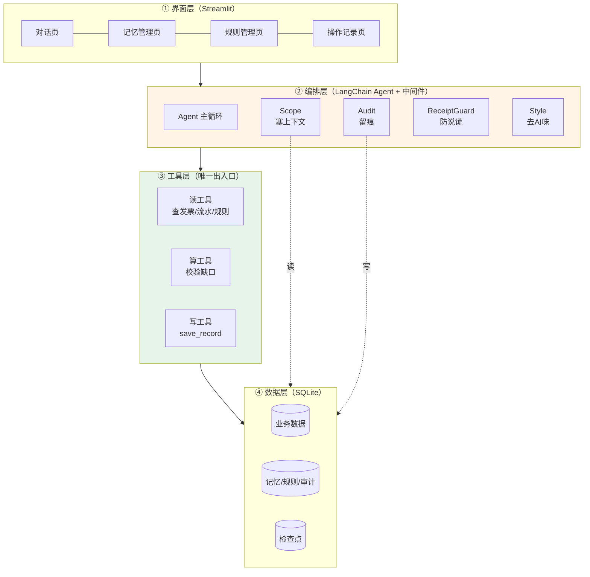

# 财税 Agent Harness 设计文档（初学者版）

> **适合谁读**：会写 Python，但没写过 LangChain，要在 16 天里做出赛题二的可运行系统。
> **读完之后你应该能做到**：说清系统分几层、每一层为什么存在、每个文件负责什么、先写哪一段代码。
> **和另外几份文档的区别**：这份是"从零讲懂整套设计"，不假设你懂 Agent；代码细节看《赛题二-LangChain实现方案》，设计取舍的完整论证看《赛题二-完整系统设计》。

---

## 0. 读之前，先记住三句话

1. **这个系统不是聊天机器人。** 它要真的查数据、真的存数据，然后把做过的事说清楚。
2. **难的地方不是让模型变聪明，是让模型少犯错。** 模型会忘事、会编数字、会说"已保存"但其实没存。
3. **所以整套设计只围绕一件事：把会犯错的模型，放进不会犯错的流程里。**

这句话是全文的骨架。后面每一章都在回答同一个问题：**这个环节，该交给模型，还是该交给代码？**

判断标准只有一条：

> 这件事错了会不会造成实际损失？
> 会 → 代码做，或者代码把关。不会 → 交给模型，省开发时间。

记住这条，你不需要背任何架构名词也能自己推出设计。

---

## 1. 先看它怎么被用（一段真实对话）

不要一上来画架构图。先看用户会怎么用它，架构是从这段对话里"长"出来的。

```
用户：帮我看看 10 月哪些发票信息不全
Agent：10 月共 42 张发票，其中 5 张缺"费用类型"，3 张缺"部门"。
       要现在补吗？

用户：补吧，缺费用类型的都记成办公费
Agent：5 张中有 2 张金额超过 5000，按《费用报销管理办法 v3》需要部门负责人确认，
       不能直接记办公费。先补这 3 张吗？

用户：行，另外我以后都按"管理费用-办公费"这个科目记
Agent：好的，记下了：你的默认费用科目是"管理费用-办公费"，只对你生效。
       现在补 3 张：INV-1001、INV-1007、INV-1033。
       已保存（回执 R-1024），3 张都已更新。

用户：（第二天）昨天那批补完了吗？
Agent：补完了，3 张，回执 R-1024。还有 2 张因为金额超限挂着，等你确认。
```

这段对话里，每一句话背后都需要一个部件。把它们圈出来：

| 用户看到的一句话 | 背后必须有 |
| --- | --- |
| "10 月共 42 张发票" | 查数据的**工具**，而且数字必须是查出来的不是编的 |
| "其中 5 张缺费用类型" | **规则**：什么算"信息不全"，得有个标准 |
| "按《费用报销管理办法 v3》" | **知识库**：规则有版本，且能说清引的是哪一版 |
| "我以后都按管理费用-办公费记" | **记忆**：跨会话保留，还得能改能删 |
| "只对你生效" | **作用域隔离**：不同人不同企业不能串 |
| "已保存（回执 R-1024）" | **写工具 + 回执**：没有回执就不许说这三个字 |
| "昨天那批补完了吗" | **任务状态**：跨天还在，不能靠"模型记得" |
| 整段话读起来像人说的 | **表达层**：不像 AI 模板 |

**这就是全部需求来源。** 七个部件，一个不能少，每个都对应一段真实对话。

---

## 2. 赛题要的 7 件事，翻译成人话

官方列了 7 项基础任务和 4 个加分项。原文比较抽象，翻译一下：

| 官方说法 | 人话 | 主要落在哪 |
| --- | --- | --- |
| 统一运行 | 不管用户说什么，系统都按同一个循环处理：看现状 → 决定查规则/调工具/问人/结束 | 第 5 章主循环 |
| 记忆管理 | 记住用户的长期偏好和任务进度；能看、能改、能删；不同企业不串 | 6.1 / 第 7 章 |
| 知识库管理 | 规则文档能加、能查、能改、能停用；回答要说是哪份哪版 | 6.4 / 第 7 章 |
| 上下文管理 | 每轮只挑该看的东西给模型，别塞爆；企业、月份不能丢 | 6.3 |
| 工具执行 | 写数据前先校验；区分"处理中/成功/失败"；不许重复写 | 6.2 / 6.5 |
| 过程可检查 | 每次工具调用、每条记忆、每条规则引用都留痕；失败要说清原因和下一步 | 第 5 章 / 第 7 章 |
| 自然表达 | 先说结果、少客套、不硬凑列点、不编造 | 6.6 |

四个加分项，一句话各说清：

| 加分项 | 一句话 |
| --- | --- |
| 长对话摘要 | 聊太长了，把前面的压缩成"已确认 / 已做 / 没做"三行，别让模型忘事 |
| 变更后仍正确 | 记忆改了、规则换版了、换了企业，下一句回答必须立刻跟上 |
| 重启恢复 | 保存到一半进程被杀，重启后不能重复保存、不能假装保存过 |
| 对比测试 | 用两种记忆方式/检索方式跑同一批题，比较正确率、耗时、花费 |

**看出来的规律**：7 项里只有"自然表达"和"统一运行"的一半跟模型有关，其余全是**工程问题**。这就是为什么用 LangChain 而不是"写个提示词"。

---

## 3. LangChain 只要懂 5 个概念

这一节当字典看，不用背。后面用到时会回来查。

### 3.1 模型（Model）

就是调大模型 API。代码里长这样：

```python
from langchain_openai import ChatOpenAI
model = ChatOpenAI(model="xxx", base_url="...", api_key="...")
```

它只会做一件事：**给一段文字，返回一段文字**（或返回"我想调用某个工具"）。它没有记忆，没有数据库，不能上网。

### 3.2 工具（Tool）

就是一个普通 Python 函数，加个装饰器，写清用途：

```python
@tool
def query_invoices(company_id: str, period: str) -> list:
    """查询指定企业指定月份的发票列表。company_id 是公司编号，period 形如 2026-10。"""
    ...
```

**关键理解**：模型不执行这个函数。模型只是"说"——我想调 `query_invoices`，参数是这些。真正执行的是框架，执行完把结果再喂给模型。

这就是"模型没有写权限"的技术基础：**它只能提议，不能执行**。

### 3.3 Agent = 模型 + 工具 + 一个循环

`create_agent(model, tools=[...])` 做的事，本质是一个 `while` 循环：

```
把对话和工具清单给模型
  ↓
模型说"我要调 query_invoices(company=..., period=...)"
  ↓
框架真的去调，把结果接回对话
  ↓
再问模型
  ↓
模型说"够了，我回答用户"
  ↓
退出循环
```

写代码时你看不到这个循环，但它一定在跑。**理解这个循环，就理解了 80% 的 Agent。**

### 3.4 中间件（Middleware）＝ 每轮必经的关卡

循环里有两个关键时刻，可以插自己的代码：

```
        ┌── 关卡 A：调模型之前 ──┐
        ↓                        │
   调模型 → 模型回复 → 关卡 B：给你看之前 → 用户
```

- **关卡 A（`wrap_model_call`）**：能改要发给模型的内容。用来**塞资料**：把企业、月份、待办、记忆、规则塞进提示词。
- **关卡 B（`after_model`）**：能改模型的回复。用来**把关**：它说了"已保存"但没有回执？改掉。它一堆"首先、其次、希望对您有帮助"？删掉。
- 还有一个 **`wrap_tool_call`**：工具执行前后，用来**留痕**。

这三个钩子，就是我们全部自研逻辑的挂载点。**不用改 LangChain 源码，不用自己写状态图。**

### 3.5 检查点（Checkpointer）＝ 游戏存档

Agent 本身没有记忆，每轮结束就忘。检查点把"这一轮的状态"存进数据库，下次带着同一个编号（`thread_id`）回来，就能接着上次继续。

```python
agent = create_agent(..., checkpointer=SqliteSaver(conn))
agent.invoke({"messages": [...]}, config={"configurable": {"thread_id": "task-001"}})
```

`thread_id` 就是**存档槽位号**：一个任务一个号。换号就是新任务，同号就接着上次。

**这就是加分项 3（重启恢复）的全部技术含量。**

### 3.6 一张表把这 5 个概念对到项目里

| LangChain 概念 | 比喻 | 在我们系统里是谁 |
| --- | --- | --- |
| Model | 会说话的脑子 | 统一接入的模型（赛方 Key） |
| Tool | 手 | 查发票、查流水、查规则、保存、查保存结果 |
| Agent | 脑子 + 手 + 循环 | `harness/agent.py` 里组装出来的那个对象 |
| Checkpointer | 游戏存档 | SQLite 里的会话状态，按 `thread_id` 存 |
| Middleware | 关卡 | 四个自研中间件：Scope / Audit / ReceiptGuard / Style |

**重要提醒**：这 5 个概念只保证"能跑"。赛题要的"记得住、不重复、说得像人"，LangChain 一个都不直接给。所以下面才有分层设计。

---

## 4. 系统分四层，每层只干一件事



四层的规矩，一句话一层：

| 层 | 只允许做 | 绝对不许做 |
| --- | --- | --- |
| ① 界面层 | 展示、收集输入、触发任务 | 写任何业务判断逻辑 |
| ② 编排层 | 决定"下一步做什么" | 直接碰数据库、直接算钱 |
| ③ 工具层 | 所有读和写，含校验、幂等、回执 | 让模型绕过它访问数据 |
| ④ 数据层 | 存 | 存业务逻辑 |

**为什么必须这样分？**

因为**越往下越确定**。模型在第②层，它不确定；第③层是普通 Python 函数，结果确定；第④层是数据库约束，连代码写错都拦得住。

出问题时你能准确定位：答案是错的 → 是模型理解错（②）还是数据查错（③）？一眼就知道。

> 这条"越往下越确定"的原则，就是答辩时"模型和规则的边界"那个评分点的答案。第 11 章给了说法。

---

## 5. 一次任务从头到尾（跟着一个请求走一遍）

这是全文最重要的一节。看完这一节，架构就懂了。

用户输入："把 10 月缺费用类型的发票都记成办公费"

| # | 谁在做 | 做了什么 | 结果存在哪 |
| --- | --- | --- | --- |
| 1 | 界面层 | 收到文字，带上 `company_id`、`user_id`、`thread_id` | — |
| 2 | 编排层 | 加载该 thread 的存档（上次聊到哪） | 检查点 |
| 3 | **Scope 中间件** | 把企业、月份、待办、相关记忆、相关规则拼进提示词 | 只影响本次调用 |
| 4 | 模型 | 决定：先查发票，调 `query_invoices` | 对话消息 |
| 5 | **Audit 中间件** | 记下：调了什么工具、什么参数、多久、什么结果 | `audit_event` |
| 6 | 工具层 | 真去查数据库，返回 42 张发票 | `tool_log` |
| 7 | 模型 | 决定：调 `check_missing` 看哪些缺字段 | 对话消息 |
| 8 | 工具层 | 按规则库判断，返回 5 张缺费用类型 | `tool_log` |
| 9 | 模型 | 决定：金额超 5000 的 2 张不能直接存，先问用户 | — |
| 10 | 编排层 | 把问题抛给用户（暂停，等人回答） | 检查点存住现场 |
| 11 | 用户 | 回答"行，补 3 张" | — |
| 12 | 模型 | 决定：调 `save_record`，带上 3 张的修改内容 | — |
| 13 | 工具层 | **五项校验** → 生成幂等键 → 写库 → 返回回执 R-1024 | `tool_log` + 业务表 |
| 14 | **ReceiptGuard 中间件** | 检查回复里有没有"已保存"，有没有对应回执 | 不合格就改写 |
| 15 | **Style 中间件** | 去套话、结论前置 | — |
| 16 | 界面层 | 显示"已保存（回执 R-1024）" | — |

看清三件事：

1. **模型在第 4、7、9、12 步只做"决定"**，它从不执行。执行都在第 6、8、13 步，是普通函数。
2. **第 3、5、14、15 步都是中间件**，模型不知道它们存在。这就是"套在模型外面的壳"。
3. **第 10 步暂停是允许的**，因为存档把现场记住了。重启也能接着走。

---

## 6. 六个关键设计（每个都从"直觉做法为什么不行"讲起）

### 6.1 记忆：为什么不直接靠对话历史

**直觉做法**：把整段对话都塞给模型，它自然就"记得"了。

**为什么不行**：

- 聊到第 30 轮，上下文塞爆，要么报错要么被截断——恰好把最早说过的偏好截掉了。
- 换一个会话（第二天再来），历史没了，偏好也没了。
- 用户说"以后都记办公费"，模型下一轮可能记成"管理费用"，你无从发现。
- 用户想删掉这条记忆，你没有地方删——它散落在聊天记录里。

**我们的做法**：记忆是**数据库里的表**，不是聊天记录。

| 记忆类型 | 存什么 | 例子 |
| --- | --- | --- |
| `user_pref` | 用户的长期偏好 | "默认费用科目 = 管理费用-办公费" |
| `company_fact` | 企业层面的事实 | "本公司小规模纳税人" |
| `task_state` | 任务进度（不是记忆，但常一起说） | 待办：2 张待确认 |

三条规矩：

1. **只记用户明确说过的**。模型不许自己推断"他大概喜欢这样"。写入前在对话里回显一句"记下了：……"，让用户有机会否认。
2. **每条带 `company_id` + `user_id`**。查询永远带作用域条件，从 SQL 层面杜绝串企业。
3. **有状态字段**（`active` / `corrected` / `deleted`）。删除是改状态，不是物理删，因为审计要能回看。

**为什么这算设计而不是功能**：因为记忆一旦写错又改不掉，就会变成系统性错误——一次错的偏好，会被之后每一次回答继承。所以"可查看、可更正、可删除"不是三个功能，是**防止错误被自我强化**的机制。

**代码落点**：`harness/memory.py`（CRUD）+ `harness/middlewares.py` 的 Scope（每轮读库）。

---

### 6.2 写数据：为什么模型不能直接碰数据库

**直觉做法**：给模型一个 `execute_sql(sql)` 工具，让它自己写。

**为什么不行**：

- 它会写出 `UPDATE invoices SET amount=0`——你没法预判它写什么。
- 同一句话用户说了两次，它会存两次，你还查不出为什么多了一条。
- 它存之前不会校验"这张发票是不是这个企业的"，跨企业写脏数据。
- 存失败了它可能告诉你"已保存"。

**我们的做法**：**唯一写入口**，一个工具 `save_record`，五项校验写死在函数里。

```python
@tool
def save_record(target: str, patch: dict, idempotency_key: str) -> dict:
    """保存对某条记录的修改。target 形如 invoice:INV-1001，patch 是要改的字段。"""
    # ① 企业校验：目标记录属于当前企业吗？
    # ② 对象校验：记录存在吗？被锁定了吗？
    # ③ 内容校验：字段类型/枚举/格式符合规则库吗？
    # ④ 权限校验：这个角色能改这个字段吗？
    # ⑤ 重复校验：这个幂等键用过吗？
    # 全过 → 在【一个事务】里写业务表 + 写日志 → 返回回执
```

**模型能做什么**：决定"要保存哪几条、改哪些字段、参数怎么填"。
**模型不能做什么**：绕过校验、跳过幂等、自己拼 SQL。

这就是"模型和规则的边界"的具体形态——**不是靠提示词求它别乱来，是它根本没有别的入口**。

**代码落点**：`harness/tools/write.py`。

---

### 6.3 上下文：为什么不是塞得越多越好

**直觉做法**：把企业信息、全部记忆、全部规则、全部历史对话一次性塞进提示词，模型总能找到要的。

**为什么不行**：

- 贵。每轮都发几万 token，加分项 4 的对比测试里你的费用会难看。
- 慢。首字延迟肉眼可见。
- **更容易错**。无关信息会干扰判断，尤其是放了三份不同版本的规则时，模型很可能引用了废止的那份。

**我们的做法**：每轮现装配，按固定顺序和预算。

| 顺序 | 放什么 | 为什么在这个位置 | 预算 |
| --- | --- | --- | --- |
| 1 | 系统指令（角色 + 硬规则） | 最前面，定基调 | 15% |
| 2 | 当前作用域（企业、月份） | 靠前，防止搞错对象 | 2% |
| 3 | 任务状态 + **未完成事项** | 靠前，防忘事 | 15% |
| 4 | 本次相关记忆（≤5 条） | 按需取，不全量 | 10% |
| 5 | 本次检索到的规则（带版本号） | 按需取 | 20% |
| 6 | 最近 6 轮对话 | 越早越不重要 | 25% |
| 7 | 最近工具结果 | 细节多，可截断 | 10% |
| 8 | 留给输出 | — | 3% |

超预算怎么砍：先砍工具结果的细节 → 再把早期对话压成摘要 → **最后剩下三样绝不砍**：未完成事项、当前企业月份、最新一轮问答。

> "未完成事项永不裁剪"这条，看着不起眼，是防"忘记前文"最有效的一招。哪怕上下文被压到极限，Agent 也知道手里还有什么没办完。

**代码落点**：`harness/context.py` + Scope 中间件。

---

### 6.4 规则：为什么不让模型"记住政策"

**直觉做法**：把公司报销制度贴在提示词里，让模型照着判断。

**为什么不行**：

- 政策会改。改了你得同步改提示词，改漏了就是拿旧规则办新账。
- 回答时说不清"依据哪一条、哪一版"，评委一问就露。
- 规则多了提示词装不下。

**我们的做法**：规则进表，带版本，带状态。

```
rule_doc(doc_id, version, title, content, status, effective_from)
        ↑ 主键是 (doc_id, version)
        status = active / deprecated
```

三条规矩：

1. **只检索 `active` 版本**。旧版留着不删，因为审计要能回看"当时依据的是哪版"。
2. **回答必须带引用**：`《费用报销管理办法》v3 第 4.1 条`。带不出引用，就不许说"按规定"。
3. **只让模型解释条款，不让它判断该用哪条**。"这笔该不该报"的最终判断，要么在规则表里配好条件，要么转人工。

**为什么用全文检索不用向量库**：初期规则就几十份，SQLite 自带的 FTS5 够用、零依赖、结果可解释（能说命中了哪个词）。向量检索是"看起来高级但调不好更难解释"的选择。等规则上千份再换，接口留好就行。

**代码落点**：`harness/rules.py`。

---

### 6.5 "已保存"这三个字，只能由回执说

这是赛题背景里点名的头号失败模式：**说已保存，其实没保存。**

**直觉做法**：让模型在调用保存工具后说"已保存"。

**为什么不行**：工具可能返回"处理中"或者"失败"，但模型看到自己调过工具，就默认成功了。用户信了，账上没有。

**我们的做法**：三态回执 + 中间件把关。

工具只返回三种结果，没有第四种：

```json
{"status": "success",    "receipt_id": "R-1024", "saved_at": "..."}
{"status": "processing", "job_id": "J-88", "retry_after_s": 2}
{"status": "failed",     "error_code": "INVALID_CONTENT", "detail": "...", "retryable": false}
```

三道防线：

| 防线 | 位置 | 作用 |
| --- | --- | --- |
| ① 幂等键 | 工具内部 | `sha256(企业+对象+改动内容)`，同一改动只成功一次 |
| ② 唯一索引 | 数据库 | `UNIQUE(company_id, idem_key) WHERE status='success'`，代码写错也拦得住 |
| ③ 回执守卫 | ReceiptGuard 中间件 | 回复含"已保存/已更新/已完成"但本轮无成功回执 → 强制改写 |

关于第②道：把"不许重复"下沉到数据库，意味着**应用层再怎么出 bug，也不可能出现两条成功记录**。这是最便宜也最硬的保障。

关于第③道，`processing` 状态时正确的话术是"正在保存，好了我告诉你"，然后轮询 `get_save_result`。**绝不预支"已保存"三个字。**

**重启恢复怎么接上**：进程重启后，恢复任务时**第一件事是拿上次的幂等键查 `get_save_result`**——有回执就跳过保存直接确认，没回执才重做。这样"重启后不重复保存"和"重启后不丢保存"同时成立。

**代码落点**：`harness/tools/write.py` + `harness/middlewares.py` 的 ReceiptGuard。

---

### 6.6 去 AI 味：为什么用代码而不用提示词

**直觉做法**：在提示词里写"请自然一些，不要用套话"。

**为什么不行**：模型对这类指令的遵守率大概七成。剩下三成，恰好出现在评委盯着看的那次演示。

**我们的做法**：**输出后处理管线**，7 条硬规则，纯代码：

| 规则 | 检测 | 处理 |
| --- | --- | --- |
| 1 结论前置 | 首句是否含结论/数字 | 不含则把结论句提到前面 |
| 2 套话清除 | 黑名单正则（"好的，""首先，""希望对您有帮助""综上所述"） | 直接删 |
| 3 列点节制 | 超过 4 条且每条 < 10 字 | 合并成一句话 |
| 4 无回执禁用完成语 | 含"已保存"且无回执 | 改写成状态描述 |
| 5 不确定要直说 | 命中不确定场景却用了肯定句 | 加"这项我不确定，建议核对 X" |
| 6 拒绝空转 | 回复无信息增量（只有"我明白了"） | 追加下一步动作 |
| 7 长度约束 | 简单问题超过 5 句 | 截断冗余，保留数字和结论 |

**为什么这算设计亮点而不是小技巧**：它把"说话像人"从**模型能力问题**变成了**工程可测问题**。你可以写单元测试断言"黑名单命中数 = 0"，模型做不到这一点。

答辩时这句话很好用：**能测的才叫保证，测不了的只是期望。**

**代码落点**：`harness/style.py` + Style 中间件。

---

## 7. 六张表，是怎么想出来的

不要背 DDL，理解"为什么需要这张表"。

| 表 | 一句话说明 | 关键字段为什么在 |
| --- | --- | --- |
| `task_state` | 一个任务一条，记录进行到哪 | `pending_items` 是"永不裁剪"的待办；`checkpoint_id` 关联存档 |
| `memory` | 记忆条目 | `company_id`+`user_id` 做隔离；`source_ref` 指向原始对话，能回看；`status` 支持软删除 |
| `rule_doc` | 规则文档，按版本存 | 主键 `(doc_id, version)`；`status` 区分现行/废止；`effective_from` 支持按业务日期取版本 |
| `tool_log` | 每次工具调用一条 | `idem_key` + `receipt_id` 是防重复的关键；`status` 三态；`latency_ms` 供对比测试 |
| `audit_event` | 事件流，只追加不修改 | `event_type` 覆盖工具/记忆/规则/提问/状态变更；界面"操作记录页"直接读它 |
| 业务表（发票、流水） | 赛方给的数据或 mock | 全部带 `company_id`，查询强制带条件 |

两条设计规矩值得单独记：

**① 每张业务表、记忆表都必须带 `company_id`。** 不是"查询时注意带上"，是**表结构里就有，查询函数签名里就有**。让"忘记隔离"这件事在代码层面写不出来。

**② 防重复的最后一层放在数据库。**

```sql
CREATE UNIQUE INDEX uq_idem ON tool_log(company_id, idem_key)
    WHERE status = 'success';
```

这行 SQL 的意思是：同一个企业、同一个幂等键，最多只能有一条成功记录。它比任何应用层判断都可靠，因为**它不依赖你的 Python 写对**。

---

## 8. 代码放哪：目录与"我要改 X 去哪"

```
tax-agent-harness/
├── app.py                 # Streamlit 四个页面（对话/记忆/规则/记录）
├── harness/
│   ├── agent.py           # 组装 create_agent，挂中间件和检查点
│   ├── middlewares.py     # 四个自研中间件
│   ├── context.py         # 上下文装配与裁剪
│   ├── memory.py          # 记忆 CRUD
│   ├── rules.py           # 规则库 + 检索
│   ├── audit.py           # 事件流写入
│   ├── style.py           # 去 AI 味 7 条规则
│   └── tools/
│       ├── read.py        # 查发票、查流水、查规则
│       ├── compute.py     # 算缺口、比对
│       └── write.py       # save_record + 五项校验 + 幂等
├── data/
│   ├── seed/              # 模拟数据 + 规则文档（赛方资料包替换这里）
│   └── harness.db
├── benchmark/             # 加分项 4 的对比测试脚本
├── tests/                 # 30 条测试用例
└── README.md              # 启动说明
```

对照表——写代码时最常用：

| 我想改…… | 去这个文件 |
| --- | --- |
| 模型说什么、怎么决定 | `harness/agent.py` 的 system prompt |
| 每轮给模型看什么 | `harness/context.py` + Scope 中间件 |
| 换数据源（mock → 赛方接口） | `harness/tools/read.py` |
| 保存前的校验规则 | `harness/tools/write.py` |
| 什么算"该问用户" | `harness/agent.py` 的提示词 + 状态机 |
| 说话风格 | `harness/style.py` |
| 记忆怎么存/怎么查 | `harness/memory.py` |
| 规则怎么检索 | `harness/rules.py` |
| 界面上加一列 | `app.py` |

**一个原则**：业务逻辑不许写在 `app.py`。界面只负责展示和触发，这样换界面（Streamlit → 网页 → 小程序）不用改逻辑。

---

## 9. 动手顺序：五个里程碑

不要按目录顺序写。按"能验证"的顺序写，每个里程碑都有明确的验收标准。

### M1 能跑通一句话（预计 2 天）

写什么：`agent.py` 组装 + `tools/read.py` 一个查发票工具 + 命令行跑通。

**验收**：问"10 月有哪些发票"，能返回真实查询结果，而不是模型编的。
**如果做不到**：先检查工具的 docstring 有没有写清参数含义——模型靠它决定怎么调。

### M2 能保存，且不重复（2-3 天）

写什么：`tools/write.py` + 五项校验 + 幂等键 + `tool_log` 表 + 唯一索引。

**验收**：连着说两次"保存"，数据库里只有一条成功记录，第二次返回的是第一次的回执。
**这是全项目最重要的一次验收**，赛题点名的失败模式就在这里被消灭。

### M3 能记住（2-3 天）

写什么：`memory` 表 + `memory.py` CRUD + Scope 中间件 + 记忆管理页。

**验收**：说"以后都按办公费记"，关掉进程重开，新会话里它还记得；在管理页把这条改成"差旅费"，下一句话立刻按差旅费走。

### M4 能解释（2 天）

写什么：`audit_event` + Audit 中间件 + 规则版本化 + 操作记录页。

**验收**：随便挑一个回答，能在记录页看到：查了什么表、命中哪条规则哪一版、保存回执号是多少。

### M5 说得像人（1-2 天）

写什么：`style.py` 7 条规则 + Style 中间件 + ReceiptGuard 中间件。

**验收**：跑 20 条测试问题，黑名单命中数为 0；"已保存"出现时必定带回执号。

### 剩下的时间留给三件事

场景串联、测试集修复、Demo 录制。**别把时间全花在写新功能上**——赛题评分里"能跑通 + 说得清"权重远高于"功能多"。

---

## 10. 初学者最容易犯的八个设计错误

| 误区 | 会发生什么 | 正确做法 |
| --- | --- | --- |
| 把整段历史当记忆 | 聊久了必爆上下文，早期偏好被截掉 | 记忆进表，每轮按需取 ≤5 条 |
| 用提示词保证不说谎 | 遵守率约七成，演示时翻车 | 回执 + 中间件硬拦截 |
| 只有几十条规则也上向量库 | 调参花两天，结果还不好解释 | FTS5 全文检索，够用且可解释 |
| 让模型生成金额/科目码/SQL | 一定会编出不存在的值 | 只让它从候选里选，或只填参数 |
| 所有工具结果都塞上下文 | 贵、慢、且干扰判断 | 按预算装配，超了先截工具结果 |
| 一个巨型 system prompt 装所有规则 | 改一处牵动全身，说不清依据 | 提示词只放角色和硬规则，知识进库 |
| 多线程共用一个 SQLite 连接 | 随机报 `database is locked` | 每次操作新建连接，或加 WAL + 超时 |
| 先做界面再做流程 | 界面很好看，功能跑不通 | 命令行先跑通主链路，最后套界面 |

第八条值得多说一句：**评委看的是主链路能不能跑通，不是界面好不好看。** 界面留到最后一天，用 Streamlit 单页足够。

---

## 11. 答辩怎么说（三个必问题）

**Q1：你为什么用 LangChain，而不是自己写？**

> 因为它把 Agent 循环、工具调用协议、检查点这三件"必须做对但没技术含量"的事做好了。我们的精力要花在赛题真正考的地方——记忆、幂等、审计、表达，这些 LangChain 一个都不给，所以四个中间件都是我们自己写的。用框架是为了省时间，不是为了省思考。

**Q2：模型和规则的边界在哪里？**

> 一条线：**模型负责理解和决定，代码负责执行和裁决。**
> 具体三层——模型只能提议调哪个工具、填什么参数，不能执行；写操作只有一个入口，五项校验写死在函数里，模型绕不过去；"已保存"这三个字只能由回执触发，模型说了不算。
> 反过来，该模型做的我们不抢：理解用户那句话什么意思、决定先查什么、怎么把结果说人话，这些规则写不出来。

**Q3：你怎么保证不重复保存？**

> 三道，一层比一层硬。应用层用幂等键，同一改动第二次直接返回第一次的回执；数据库层加部分唯一索引，同一企业同一幂等键最多一条成功记录，代码写错也拦得住；重启恢复时先拿幂等键查上次结果，有回执就跳过。
> 我可以现场演示：连说两次保存，然后打开数据库给你看只有一条。

---

## 12. 学习路径：什么时候读哪一节

| 你的状态 | 读这里 |
| --- | --- |
| 刚开始，想搞懂要做什么 | 第 1、2 章（30 分钟） |
| 没写过 LangChain | 第 3 章 + 《LangChain实现方案》第 2 章的 30 行 demo |
| 准备动手写代码 | 第 5、8、9 章（照着里程碑走） |
| 写到一半卡住 | 第 6 章对应小节 + 第 10 章误区表 |
| 准备答辩 | 第 11 章 + 《完整系统设计》第 2.3 节 |
| 想深挖原理 | 《财税Agent-Harness系统设计》 |

四份文档的分工：

| 文档 | 什么时候看 |
| --- | --- |
| **本文（初学者版设计）** | 入门、理清结构、答辩前顺一遍 |
| 赛题二-LangChain实现方案 | 写代码时对照，一节一个功能 |
| 赛题二-完整系统设计 | 交设计说明、答辩深问 |
| 财税Agent-Harness系统设计 | 被问到原理层（数值溯源、策略引擎）时查 |

---

## 附：八句话记住整套设计

1. 模型只提议，不执行。
2. 写只有一个入口，校验写在函数里。
3. 记忆进表不进聊天记录，只记用户明确说过的。
4. 规则带版本，只查现行版，引用要能说出哪一版。
5. 上下文按预算装配，未完成事项永不裁剪。
6. "已保存"必须凭回执，幂等键 + 唯一索引兜底。
7. 说话风格靠代码兜底，能测的才叫保证。
8. 先跑通命令行主链路，界面留到最后。
